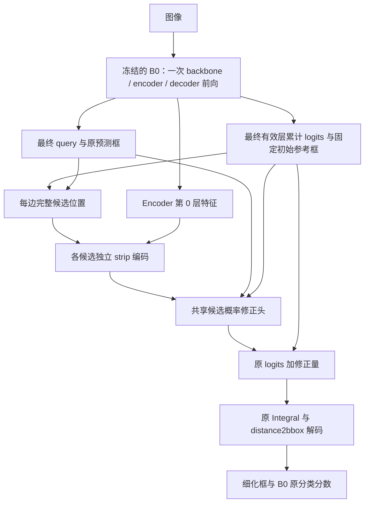

# P3：基于 Strip 特征的候选概率校准方案

日期：2026-09-23

状态：P3 首版代码已完成，18 项局部 CPU 测试及 Slurm 脚本语法检查通过，尚未启动 GPU 接入检查或训练。Decoder strip 阶段停止追加缩放诊断。运行入口与实施记录见第 11 节；既有实验记录见 [预测引导阶段记录](prediction_guided_strip_refinement_plan.md)。

## 1. 目标与核心判断

在不使用 GT 推理的条件下，用每个候选位置的 strip 特征修正 D-FINE 原有边界概率，再通过原有分布积分方式得到预测框。

核心变化是：**把逐候选的视觉证据直接用于概率修正，并对修正后的候选分布施加监督。** 原概率继续作为先验，模型学习其修正量。首版仅校准最终有效 decoder 层的输出，不再经过 query 残差和冻结 bbox head 来间接改变分布。

这是一项新的研究假设。已有结果支持候选集合具有利用潜力，但尚未证明视觉特征可以可靠地选出正确候选，也未证明直接校准一定优于 query 反馈。

## 2. 已有证据与路线选择

下表采用各实验训练日志中最佳 AP 对应轮次的指标，均以当前集群的强 B0 为参照；不混入早期较弱 baseline 或小样本诊断指标。AP 使用百分数尺度。

| 实验 | 核心方式 | 最佳 AP | AP75 | 结论 |
| --- | --- | --- | --- | --- |
| B0 | 原始检测器 | 59.8366 | 65.9820 | 真实推理基线 |
| G1 | GT 边界位置和跨度，匹配 query 细化 | 78.7432 | 88.2598 | 正确边界信息有很大潜力 |
| P1 | 单个预测框位置采样，框残差输出 | 59.8574 | 65.9477 | 没有明确收益 |
| P2 | 全部候选编码，原概率融合，框残差输出 | 59.8749 | 65.8302 | 扩大候选覆盖后仍没有明确收益 |
| GT 最近候选 | GT 选择候选特征，预测跨度，框残差输出 | 78.1457 | 88.0152 | 同一候选集合存在有用的选择 |
| Decoder strip | 最后两层共享 query 适配器 | 59.8597 | 66.0038 | 逐层反馈首版没有明确收益 |

P2 全验证集诊断显示：四边都有距离 GT 不超过 1 输入像素的候选的比例为 95.74%，单框采样对应为 23.68%。这说明候选覆盖改善，不表示原概率已选中这些位置。

Decoder strip 的 96 图、685 对固定 B0 匹配诊断显示：末轮两层 query 残差相对范数约为原 query 的 3 倍，而最终平均 IoU 变化仍接近零。它说明反馈实际发生、修正幅度未转化为有效定位；不能据此把唯一原因归为幅度过大，也不能推断所有多层方案都无效。

选择 P3 的理由是缩短“候选视觉证据 → 边界概率 → 预测框”的学习路径。此前 P2-S 备选仍将学习权重用于特征融合、再预测框残差；P3 则直接输出分布修正，省去该框残差映射。

GT 最近候选实验使用的是“选择候选特征后再回归框”，且前向依赖 GT。其 78.15 AP 不能作为 P3 直接积分候选坐标的性能上界。P3 同时改变输出方式和监督目标，首轮结果只能评价这一组合设计；若取得收益，再区分各部分的贡献。

## 3. 首版数据流与实验边界



固定以下条件：

- 使用同一强 B0，冻结 backbone、encoder、decoder 及原分类/回归头，保持 eval 模式。只训练新 strip 编码和概率修正分支。
- 从全新分支开始，不继承 P2、GT 最近候选或 decoder strip 的头参数。
- 处理最终有效层，当前六层配置对应索引 5；不启用 `query_refiner`，不向前层反馈，也不执行第二遍 decoder。
- 对全部正常检测 query 采用相同预测流程，不输入去噪 query，不根据 GT 或 GT 匹配筛选前向。
- 沿用每边 33 个候选、预测沿边跨度、5 个沿边采样点、内外各 1 输入像素的三列 strip、隐藏维度 64、query 分块大小 32。候选数实际从分布形状推导。
- 保留 B0 分类 logits 和后处理；GT 仅进入独立 criterion。图像相同时，更换或移除 targets 不改变模型输出。

## 4. 候选概率如何校准

### 4.1 保留候选维度

复用现有候选生成与 `encode_distribution_candidates`。输出特征为 `[B,Q,4,K,H]`，其中四边顺序为左、上、右、下。**进入概率修正头之前，不沿 K 维做原概率加权求和。** 否则不同位置的视觉证据会提前混合，无法分别输出修正量。

共享小型 MLP 读取每个候选的：

- strip 编码特征；
- 最终 query 的投影特征；
- 四边类型嵌入；
- 相对原预测边的位置偏移，左右边按原框宽归一化、上下边按原框高归一化；
- 原始 log 概率。

首版投影与隐藏维度为 64，边类型嵌入维度为 8；拼接后经一层 64 维隐藏层和标量输出层。四边、全部候选共享该 MLP。位置采用真实坐标偏移，不能用 bin 编号代替非均匀的几何距离。

### 4.2 原概率作为先验

设原累计边界 logits 为 `z`，修正量为 `Δs`：

\[
z'_{q,e,k}=z_{q,e,k}+\Delta s_{q,e,k},\qquad
p'_{q,e,k}=\operatorname{softmax}_k(z'_{q,e,k}).
\]

它等价于 `softmax(log(p_original) + Δs)`。实现使用原 logits 直接相加，并用 `log_softmax(z)` 构造输入特征，避免先求概率再取对数造成数值问题。这里的概率是**四边候选分布**，不是目标类别置信度。

最终标量输出层的权重和 bias 均初始化为零，使初始 `z'=z`。原 logits、参考框、query、采样几何及冻结特征均 detach；新增特征投影、strip 编码、MLP 和积分解码到新分支之间保留梯度。首版不加入额外温度、query 门控或分布蒸馏损失。

### 4.3 采样有效性不等于分布支持集

现有 P2 的 `masked_softmax` 用于融合有效采样特征。P3 **不能直接把它作为最终解码概率**：剔除越界采样候选并重新归一化，会让零修正时的分布也偏离 B0。

首版规则为：

1. 沿用已有点与候选有效性规则计算视觉证据。
2. 无有效视觉证据的候选，其 `Δs` 固定为零；原 logits 仍保留在完整 K 类 softmax 中。
3. 原分布、原框或 query 无效，或任意一条边没有有效采样候选时，该 query 整体保留 B0 框。
4. 新框非有限或宽高非正时保留 B0 框。所有回退条件只依赖预测信息。

注意：无效采样候选的 logits 不变，并不代表其概率质量不变；其他候选 logits 改变后，完整 softmax 的归一化分母也会改变。这是本版明确采用的规则。

## 5. 输出与 D-FINE 几何保持一致

从冻结 decoder 读取最终累计 `pred_corners`、固定初始 `ref_points`、`up` 和 `reg_scale`。最终框由校准 logits 经已有 `weighting_function` / `Integral` 和 `distance2bbox` 解码得到。

需要保持三个约定：

- 分布参考框是固定初始参考框，不能替换为最终预测框或逐层注意力参考框。
- 候选支持和间距沿用 D-FINE 的非均匀定义，不把 33 类当作等距像素。
- 原预测框只提供沿边跨度和候选相对偏移的基准；不再额外叠加一个独立框残差头。

在不触发回退时，零修正应在浮点精度范围内还原 B0 框。不能为了达到等价而用“修正量是否为零”的条件跳过解码，这会切断初始学习路径。

## 6. 用 GT 直接监督候选分布

### 6.1 固定原始匹配

criterion 使用 B0 原分类 logits 与 `baseline_boxes` 完成 Hungarian 匹配，再在相同匹配对上计算框损失和分布损失。模型前向不接收匹配索引或任何 GT 派生权重。未匹配 query 仍正常前向，首版不增加额外背景分布目标。

### 6.2 两个相邻候选的软目标

对某条匹配边，设 GT 坐标为 `g`。按真实边界坐标找到包围它的两个相邻候选 `x_a ≤ g ≤ x_b`，分配：

\[
t_a=\frac{x_b-g}{x_b-x_a},\qquad
t_b=\frac{g-x_a}{x_b-x_a}.
\]

其他候选目标为零。这样两点目标的坐标期望等于 GT 边界，比最近候选 one-hot 更适合最终采用分布期望解码的输出形式。

标签构造必须遵循：

- 坐标使用与训练框一致的归一化图像坐标；也可统一换算为输入像素，但不能混合尺度。
- 按坐标顺序查找相邻候选，并保留到原 logits bin 的索引映射；左/上边的候选坐标顺序与支持值方向相反。
- 恰好落在候选位置时采用该点 one-hot；在整个原始支持范围之外时跳过该边的分布损失，不强行夹到端点。
- 对非零目标权重对应的候选，若缺少有效 strip 证据，跳过该边的分布监督；不重新拼接一组“有效候选支持”。
- 分布监督有效性根据原几何、GT 和采样有效性决定，不根据当前校准框是否有效决定，避免错误预测直接关闭自己的概率监督。

以实际有效的匹配边数归一化软交叉熵：

\[
L_{\text{candidate}}
=-\frac{1}{N_{\text{edge}}}\sum_{(q,e)\in\mathcal V}\sum_k
t_{q,e,k}\log p'_{q,e,k}.
\]

空集合返回与新分支相连的零损失。分布式训练采用全局有效边数一致归一化；同时记录参与分布监督的边数与比例，避免只看到损失下降却不知道监督覆盖发生变化。

### 6.3 联合目标

\[
L=5L_{\text{L1}}+2L_{\text{GIoU}}+0.05L_{\text{candidate}}.
\]

框损失沿用现有预测细化 criterion 的固定匹配和有效性处理。`0.05` 是首版固定起点，不是已证实的最优值；记录未加权和加权的候选损失，首轮不开展系数搜索。

原 P2-S 的最近候选硬标签服务于“选择特征”；本方案的两点软标签服务于“期望坐标解码”。二者目标不同，不能直接照搬硬分类准确率作为 P3 的主要成功指标。

## 7. 代码接入范围

以下为 P3 的实施位置。新增模型与 criterion 独立注册，不改变已有实验的模型选择。

| 文件 | 职责 |
| --- | --- |
| `src/zoo/dfine/strip_probability_head.py`（新） | 保留逐候选特征，输出 logits 修正，完成完整分布积分和预测回退 |
| `src/zoo/dfine/probability_refinement.py`（新） | 注册 `DFINEProbabilityRefiner`，复用 B0 加载与冻结约束，一次 decoder 前向后调用新头 |
| `src/zoo/dfine/probability_refinement_criterion.py`（新） | 注册 `ProbabilityRefinementCriterion`，固定 B0 匹配，构造两点软目标并联合框损失 |
| `src/zoo/dfine/pred_strip_head.py`（按需） | 复用候选几何和编码；只有新头确实需要时才抽取共用函数，保留 P2 行为 |
| `src/zoo/dfine/__init__.py` | 注册新模型与 criterion |
| `src/solver/det_engine.py` | 从 criterion 的 `last_candidate_stats` 读取脱离梯度的候选监督统计，单独写入日志，不计入总损失 |
| `configs/dfine/pred_refinement/dfine_hgnetv2_l_uavswarm_pred_p3.yml`（新） | 继承同一数据与训练预算，配置概率校准分支及候选损失 |
| `slurm_files/run_train_dfine_uavswarm_pred_p3.slurm`（新） | 独立实验输出目录，拒绝覆盖已有结果 |

模型保留既有 `pred_boxes`、`pred_logits`、`baseline_boxes`、`refinement_mask`、`refinement_zero_loss` 字段。另提供 `calibrated_corners`（`[B,Q,4,K]`，保留梯度）以及 detach 的候选坐标、候选有效性和输入有效性，供 criterion 使用。

具体字段名为 `candidate_positions`、`candidate_valid`（均为 `[B,Q,4,K]`）和 `input_valid`（`[B,Q]`）。`input_valid` 表示解码前可修正的 query，`refinement_mask` 还包含解码后框有效性；候选损失使用前者，框损失使用后者。

不能把 `calibrated_corners` 放入现有 `sampling_diagnostics` 的统一 detach 路径。诊断数据可 detach，但概率损失必须连接到校准头。

现有 decoder strip 适配器、callback 和实验入口保留，不为 P3 再扩展其反馈流程，也不迁移已有日志或结果文件。

## 8. 后续实施顺序与训练设置

实施顺序与当前进度：

1. 已实现概率校准头及最终层包装器，保持 B0 初始分布和原分类分数。
2. 已接入固定匹配的软目标 criterion、候选监督日志及首轮主实验 P3 配置。
3. 训练尚未启动。后续使用独立 Slurm 任务完成同预算训练，再归档正常检测结果。

相关行为测试覆盖零修正等价、非均匀坐标软标签、左右方向映射、候选 mask 不破坏先验、概率损失梯度及 GT 前向独立性。本轮仅运行对应的局部 CPU 测试，不追加缩放诊断或 GPU 接入任务。

| 项目 | 首版设置 |
| --- | --- |
| B0 初始化 | `/cluster/home/zzy/D-FINE/output/uavswarm_strip_20260923/b0/best_stg2.pth` |
| 图像目录 | `/cluster/home/zzy/dataset/UAVSwarm-dataset-master/train` |
| 标注 | 同数据根目录的 `annotations/train_half.json` 与 `annotations/val_half.json` |
| 数据规模与输入 | train 3,450 / val 3,394；640×640 |
| 训练预算 | 12 epochs，总 batch 96，seed 0 |
| 优化器 | AdamW，lr 0.00025，weight decay 0.000125 |
| 调度 | 沿用 P1/P2 的 warmup 50 steps、epoch 10 降 lr 至 0.1 倍 |
| AMP / EMA | AMP 开启，EMA 关闭 |
| 计划输出 | `/cluster/home/zzy/D-FINE/output/uavswarm_strip_beststg2_20260923/p3_probability_calibration` |

该输出目录尚无本轮提交的任务或 checkpoint。代码完成后的运行入口与使用说明见第 11 节。

## 9. 如何解释下一轮结果

首轮主要比较正常验证集 AP、AP75、AP small，同时保留最佳 AP 所在轮次和末轮，参照同一 B0、P2 和 decoder strip。候选损失下降只表示训练目标改善，不能代替检测收益。

- **有明确检测收益：** 再安排确认复现，并以相同结构去掉候选监督的对照区分直接监督的作用；若要归因于 strip 视觉证据，还需相应的特征对照。
- **候选监督改善，检测仍在 B0 附近：** 暂不扩展到多层，先根据训练结果判断候选目标、期望解码和正常检测 query 的适配问题。
- **训练分布损失也无改善：** 重新考虑逐候选特征的可辨别性和输入设计，不直接归咎于原概率不足或增加训练轮数。

沿用相对 B0 增加 0.5 个 AP 百分点作为值得复验的工程门槛，并要求 AP75 同向改善；这不是统计显著性判据。只有类似已有实验的 0.0x 个百分点变化，不足以据此扩展多层结构。

现阶段选择单层直接校准，是为了先研究更直接的学习目标。此前多层 refine 的设想仍可在单层取得收益后再研究，不据当前结果提前否定或扩展。

## 10. 关联记录

- [阶段方案、实验结果与代码索引](prediction_guided_strip_refinement_plan.md)
- [P2 全验证集覆盖与定位诊断](results/p2_diagnostics_beststg2.json)
- [GT 最近候选选择结果](results/p2_gt_nearest_oracle_beststg2.json)
- [Decoder strip 接入检查归档](results/decoder_strip_integration_check_beststg2.json)
- [Decoder strip 小样本逐层诊断](results/decoder_strip_diagnostics_subset_beststg2.json)

## 11. 实施记录与使用入口

P3 使用独立的 `DFINEProbabilityRefiner` 和 `ProbabilityRefinementCriterion`，新参数统一位于 `refiner.*`。原有 B0、P1/P2、GT oracle 和 decoder strip 的模型与配置继续保留。

训练日志新增以下字段，均为 detached 统计，不会重复计入优化目标：

| 字段 | 含义 |
| --- | --- |
| `loss_candidate` | 实际参与反传的加权候选交叉熵 |
| `candidate_loss_unweighted` | 全局有效匹配边上的平均交叉熵 |
| `candidate_loss_weighted` | 上述全局均值乘候选损失权重，便于对照训练损失 |
| `candidate_edges` | 当前全局 batch 的有效监督边数 |
| `candidate_edge_fraction` | 当前全局 batch 有效监督边数 / 全部 B0 匹配边数 |

epoch 日志对这些 batch 统计取平均，因此 `train_candidate_edges` 是每个全局 batch 的平均边数，`train_candidate_edge_fraction` 是 batch 比例的均值，不能当作整个 epoch 汇总计数得到的比例。

局部 CPU 测试文件为 `tests/test_strip_probability_head.py`、`tests/test_probability_refinement_criterion.py` 和 `tests/test_probability_refinement.py`。它们使用合成张量或小型真实 decoder，不读取集群数据或训练 checkpoint。

本轮三组测试分别为 7、6、5 项，全部通过。包括完整分布零初始化等价、图像特征到新分支的梯度、非均匀及反向候选坐标的软标签、无效预测和空 GT、稀疏有效边数的 DDP 归一化、一次 decoder 前向、GT 独立性及配置注册。候选监督改为批量 sort/searchsorted/gather 后，又复跑了联合损失与冻结状态的集成测试，通过。Slurm 脚本通过 `bash -n`；未进行实际多 GPU/AMP 运行。

准备正式训练时，在项目根目录执行：

```bash
mkdir -p logs/dfine_uavswarm_pred_p3
sbatch slurm_files/run_train_dfine_uavswarm_pred_p3.slurm
```

脚本默认从本方案列出的 B0 `best_stg2.pth` 加载检测器，训练全新的 P3 分支。若输出目录已存在，脚本会退出；新实验可通过 `OUTPUT_DIR` 指定另一个目录，恢复训练则使用该实验 checkpoint 和训练器的 resume 入口。代码交付不自动提交 Slurm 任务，也不自动 commit。
