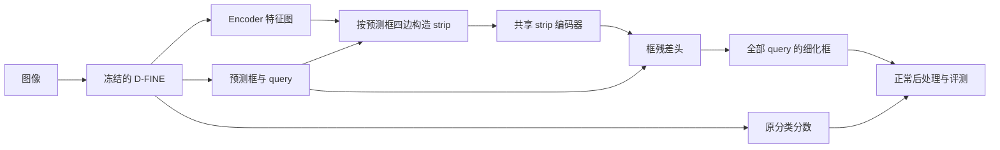

# D-FINE 预测信息引导的 Strip 边界细化方案

日期：2026-09-22

状态：当前集群的 B0 → G1 → P1 已完成，并已用 B0 最佳 `best_stg2.pth` 完成 G1/P1 复验和 P1 全验证集定位诊断。强基线上 P1 尚无有效增益。P2 完整候选采样已实现，局部测试及真实 GPU 单 batch 接入检查通过，详见第 13 节；尚未启动完整 P2 训练，P3 尚未实现。

本文承接 [GT 引导阶段方案](distribution_guided_strip_head_with_gt_oracle.md)，细化其中第 6 节的后续方向。原文关于“当前实施 GT 阶段”的表述保留为历史背景，下一阶段以本文为准。

**目标：** 在推理完全不使用 GT 的条件下，利用预测框及 D-FINE 四边分布选择 strip 采样位置，检验能否保留 GT 实验中的定位收益。

**整体结构：** 冻结已训练的 D-FINE，读取 Encoder 特征、最终有效解码层的 query 和预测信息；新增 strip 模块提取边界证据，先沿用框残差头，再研究分布残差头。

**实现基础：** 当前仓库的 PyTorch、`grid_sample`、D-FINE 分布解码及配置注册体系，不引入新依赖。

## 1. 阶段划分与范围

| 阶段 | 采样引导 | 特征融合与输出 | 要回答的问题 |
| --- | --- | --- | --- |
| G：已完成的 GT 实验 | GT 边界位置和沿边跨度 | strip 编码 + 框残差 | 正确边界附近的特征是否有利用价值？ |
| P1：预测框引导 | 原预测框的四边位置和跨度 | 保留现有编码结构和框残差形式 | 仅有实际预测位置时，能保留多少收益？ |
| P2：预测分布引导 | 四边完整候选位置；跨度来自原预测框 | 候选 strip 共享编码，按预测概率融合，再输出框残差 | 多位置取证能否弥补单框采样的位置误差？ |
| P3：分布直接细化 | 与 P2 对齐的候选集合 | 逐候选预测 logits 残差并重新解码 | 视觉证据能否修正原有边界概率判断？ |

近期实现顺序为 P1 → P2。P3 只约定研究方向和进入条件，不纳入首轮实现任务。端到端解冻、额外高分辨率分支、稀疏候选优化及完整结构消融均在预测引导得到正面结果后开展。

本文最初作为方案交付，现按用户授权推进 P1；实施记录见第 10 节。后续阶段性代码完成后，获得用户批准才提交，提交说明使用中文。

## 2. 从 GT 实验到正常检测的数据边界

当前 [GT 包装器](../../src/zoo/dfine/gt_refinement.py) 使用 GT 完成三件事：决定边界法向位置、决定沿边跨度、通过 Hungarian 匹配选择需要细化的 query。预测版本必须同时解除这三处前向依赖。

统一规则：

- 模型对全部正常检测 query 执行相同的预测引导策略；不包括训练用的去噪 query。P1/P2 的冻结检测器始终处于 eval，因此沿用正常 query 输出。
- 首版不根据 GT 匹配、GT 数量或预测置信度筛选待细化 query。无效预测或无有效采样证据时保留原框，判定只使用模型输出和图像尺寸。
- 训练时 GT 仅进入 criterion，用于匹配和监督；不进入采样器、特征融合器或框修正头。
- 同一模型状态、同一图像下，传入不同 GT 或不传 GT，预测框、分类分数和细化 mask 均应一致。
- 评测采用正常检测流程，GT 只由评测器用于计算指标。设置 `requires_gt=False`，不标记为 oracle 评测。
- G 的指标保留为 GT 辅助诊断结果；P1/P2 的无 GT 全图指标与原基线直接比较，G 不是严格性能上界。

## 3. P1：预测框四边 Strip + 原框残差头

### 3.1 数据流与接口



新包装器拟命名为 `DFINEPredRefiner`，对外保留 `forward(images, targets=None)` 以兼容训练器；`targets` 不参与模型预测。主要输出：

| 字段 | 形状/含义 | 用途 |
| --- | --- | --- |
| `pred_boxes` | `[B, Q, 4]`，归一化 `cxcywh` | 细化框，直接交给原后处理 |
| `pred_logits` | `[B, Q, C]` | 原分类 logits，不由细化头修改 |
| `baseline_boxes` | `[B, Q, 4]` | 细化前原框，供 criterion 固定匹配 |
| `refinement_mask` | `[B, Q]`，布尔值 | 由预测信息决定的细化有效性 |
| `refinement_zero_loss` | 标量 | 空有效集合时保持新增参数梯度连接 |

不要求模型返回 GT、匹配索引或 GT 派生的候选权重。criterion 使用原分类 logits 和 `baseline_boxes` 生成配对。

### 3.2 采样几何

将原预测框转为归一化四边 `(L, T, R, B)`。左右边沿 `[T, B]` 采样，上下边沿 `[L, R]` 采样；首版继续使用 5 个沿边采样点以及内侧、边上、外侧 3 列。

首版沿用当前参数：`feature_level=0`、`hidden_dim=64`、`num_points=5`、`kernel_size=3`、`offset_pixels=1.0`、`max_log_scale=2.0`。偏移单位是网络输入图像像素，按输入宽高归一化，不能当作特征图像素。

继续使用 `align_corners=False`、双线性插值、图像外采样点 mask 以及图像边缘的 border padding。P1 沿用现有严格有效性规则：每条边的每列至少有一个有效采样点，且原框与 query 有限、框宽高为正，才接受细化；否则输出原框。有效性不能读取 GT。

1 像素偏移首先用于控制与 G 的结构差异，不预设它足以覆盖实际定位误差。若 P1 收益不足，应结合误差诊断判断采样覆盖问题，再进入 P2；不立即把结论归因于 strip 无效。

### 3.3 编码与框更新

复用 [现有 strip head](../../src/zoo/dfine/gt_strip_head.py) 的共享沿边卷积、内/边/外列融合、四边特征拼接以及 query 和原框几何输入形式。P1 首先通过薄适配层将原预测框同时作为待修正框和采样框，保留 GT 实验接口与行为。

框更新仍采用：

\[
c'_x=c_x+w\Delta_x,\quad c'_y=c_y+h\Delta_y,\qquad
w'=w\exp(\operatorname{clip}(\Delta_w,-M,M)),\quad
h'=h\exp(\operatorname{clip}(\Delta_h,-M,M)).
\]

新增头最后一层零初始化，使起始输出等于原框。首轮不改变类别、分数、query 数量或后处理规则。

## 4. P2：完整分布候选 Strip + 相同框残差头

### 4.1 原模型需要提供的信息

当前 [decoder](../../src/zoo/dfine/dfine_decoder.py) 在 eval 下可通过 `return_query=True` 返回 query；边界分布和对应初始参考框已经在内部计算，但 eval 默认未返回。

新增可选 `return_distribution=True`，在冻结检测器的 eval 路径额外返回：

- `pred_corners`：`[B, Q, 4 * K]`，当前输出层的累计边界 logits，`K = reg_max + 1`；
- `ref_points`：`[B, Q, 4]`，这些分布所对应的初始参考框；
- `up`、`reg_scale`：恢复原非均匀支持值的参数。

新增参数默认为 False，普通 detector 和 P1 的调用行为不变。query、框、logits 和参考框必须属于相同输出层；若配置 `eval_idx` 提前停止，就使用该层状态。参考框使用第一层生成并固定的 `ref_points_initial`，不能替换成最终预测框或逐层更新的 attention reference。

### 4.2 候选坐标与条带形状

将 logits reshape 为 `[B, Q, 4, K]`，在每条边的 K 维进行 softmax，得到 `p[j,k]`。支持值 `v[k]` 必须由当前 [weighting_function](../../src/zoo/dfine/dfine_utils.py) 生成。

对初始参考框 `(cx0, cy0, w0, h0)`，令 `s = abs(reg_scale)`，与原 `distance2bbox` 一致的候选坐标为：

\[
\begin{aligned}
L_k &= c_{x0}-w_0/2-v_k w_0/s, & R_k &= c_{x0}+w_0/2+v_k w_0/s,\\
T_k &= c_{y0}-h_0/2-v_k h_0/s, & B_k &= c_{y0}+h_0/2+v_k h_0/s.
\end{aligned}
\]

这些都是网络输入的归一化坐标。bin 编号不是等间隔像素偏移；左/上边的候选坐标随支持值增大而减小，必须保留概率与原 bin 的对应关系。

每个候选只改变所在边的法向位置，沿边跨度使用最终原预测框。例如右边候选 `R_k` 沿原预测框的 `[T, B]` 采样。首版不枚举其他三边的组合，不将四个边缘分布解释成联合框分布。

首版使用全部 K 个候选，不做概率 top-k 筛选，也不混入 GT 候选。这样先判断完整预测候选集合是否足够，再研究减少采样量。

### 4.3 候选编码与融合

每个候选得到与 P1 相同规格的 strip，并共享同一套 strip 编码和列融合参数，形成候选边特征 `e[j,k]`。先分别编码候选，再融合；不先平均采样位置，也不把平均位置上的单条 strip 当成多候选特征。

令 `m[j,k]` 表示候选的三列均至少有一个图像内采样点。仅对有效候选归一化概率：

\[
\widetilde p_{j,k}=\frac{m_{j,k}p_{j,k}}{\sum_r m_{j,r}p_{j,r}},\qquad
\bar e_j=\sum_k\widetilde p_{j,k}e_{j,k}.
\]

实现时用 FP32 masked softmax 计算有效候选权重；某条边没有有效候选、分布不合法或参考信息不合法时，不计算该归一化，并保留该 query 的原框。记录每条边被排除候选的原始概率质量，区分模型先验和边界 mask 的影响。

四条边的融合结果仍是 `[N, 4, hidden_dim]`，接入与 P1 相同的框残差结构。P2 不重新定义分布支持、不更新原 logits，不将细化框误称为原分布解码结果；原分布只作为采样与融合的引导信息。

### 4.4 能力与限制

P2 增加了可观察的位置，但概率加权仍可能压低真实边界附近的低概率证据；候选集合也未必覆盖 GT 边界。沿边跨度继续依赖预测框，因此法向覆盖良好不保证整条边都取证正确。这些均通过第 7 节诊断区分，不预设完整分布等于可靠的不确定性估计。

对 Q 个 query，P1 每图采样点数为 `Q × 4 × 5 × 3`，P2 为其 K 倍。Q=300、K=33 时分别为 18,000 和 594,000 点。按图共享投影后的特征图，不为每个候选复制整图；必要时分块采样，保持数学结果不变。采样点数不等于真实延迟。

## 5. 训练策略与公平比较

### 5.1 冻结范围与初始化

本轮在当前集群重新训练 B0：沿用 HGNetv2 骨干预训练初始化，Encoder、Decoder 和检测头按原基线流程重新训练，不加载旧检测器 checkpoint。初轮 G1/P1 使用 `best_stg1.pth`；依据第 12 节的强基线复验，后续 P2 与新 G1/P1 统一使用 B0 `best_stg2.pth`，加载其中 EMA 检测器权重（存在时）。

G1/P1/P2 的骨干、Encoder、Decoder 和原预测头冻结，并保持 eval；只训练 strip 特征投影、编码器和框残差头。读取的框、query、特征及边界分布均 detach。

主对照中 P1/P2 从相同初始化规则的新头开始训练，最后一层为零；不让某一版本额外继承已经训练的 G 或 P1 权重。GT 实验头可以作为后续加速收敛对照的初始化，但需单独标注来源及额外训练预算，且仍须在预测引导下训练。

冻结模型阶段不修改 FGL、原 LQE 或层间蒸馏。保持分类分数固定有助于隔离框细化效果，但分数与新定位质量可能不完全匹配，最终以完整检测指标判断收益。

### 5.2 匹配与损失

新增 `PredRefinementCriterion`，在训练时读取 `targets`，使用细化前的 `baseline_boxes` 与原分类 logits 做 Hungarian 匹配，不按细化结果重新匹配。匹配成本沿用当前配置：`cost_class=2`、`cost_bbox=5`、`cost_giou=2`、`alpha=0.25`、`gamma=2.0`。

仅对匹配成功且 `refinement_mask=True` 的预测计算 `5 × L1 + 2 × GIoU`。训练框格式沿用归一化 `cxcywh`，有效框/忽略标注处理沿用现有 GT 实验规则；损失按跨进程平均的有效配对数量归一化，数量为零时通过 `refinement_zero_loss` 返回零损失。

未匹配 query 也参与预测和正常评测，但没有框回归监督。首版不额外加入背景框恒等损失或置信度门控；需观察这些 query 的位移与假阳性变化，再决定是否需要新约束。不能在评测时借助 GT 把未匹配 query 恢复为原框。

### 5.3 训练配置

首轮配置以当前 UAVSwarm GT 阶段配置为模板，独立建立预测版本：固定 640×640 输入、12 epochs、AdamW 学习率 0.00025、weight decay 0.000125、第 10 epoch 衰减至 0.1 倍、warmup 50 iterations、关闭 EMA，其他数据与优化参数保持一致。复现实验时应记录实际已完成 G 实验的配置差异，以真实实验记录为准。

P2 的采样量增加；若显存不足，优先在单次 forward 内分块处理 query/候选。若必须改变有效 batch 或训练预算，需同步调整 P1 比较条件或明确记录差异，不直接沿用旧结果作等预算结论。

## 6. P3：候选视觉证据直接修正分布

当 P2 的候选覆盖和特征利用已有正面证据后，再将候选自身特征、概率加权上下文、query 及候选相对预测边界的几何信息送入逐候选评分头：

\[
\Delta z_{j,k}=h(e_{j,k},\bar e_j,q,\pi^{pred}_{j,k}),\qquad
z'_{j,k}=z_{j,k}+\Delta z_{j,k}.
\]

新增 logits 残差零初始化，使用原参考框与原支持值解码新分布。无有效证据时回退原分布。`pi_pred` 只能由预测信息构造，不输入 GT 位移。

进入该阶段前，另行细化 FGL 与框损失的配合、LQE 与新分布的一致性，以及是否保持冻结模型。仅细化最终输出层时不默认修改所有层或引入新的层间蒸馏；解冻和向中间层传播属于独立实验。

P3 同时改变输出方式与监督设计，必须与 P2 单独比较，不能把 P3 与 G 的差异全部归结为采样位置误差。

## 7. 实验与诊断

### 7.1 首轮实验集合

| 编号 | 模型/设置 | 使用 GT 采样或选择 query | 比较目的 |
| --- | --- | --- | --- |
| B0 | 原冻结 baseline | 否 | 正常检测基准 |
| G1 | 在新 B0 上重新训练的 GT strip 实验 | 是 | 复现 GT 边界取证收益 |
| P1 | 预测框四边 strip + 框残差 | 否 | 建立最小可部署路径 |
| P2 | 全候选预测分布 strip + 概率融合 + 框残差 | 否 | 衡量多候选引导的增益 |

按 2026-09-23 确认的安排，本轮 B0、G1、P1 重新训练；另一设备的旧结果仅作研究背景，不与本轮结果作同权重数值对照。P1/P2 各自按预测引导训练和评测，不能只在推理时切换采样输入。

### 7.2 必要观测

- **正常检测：** 完整验证集的 AP、AP75、AP50；优先关注 AP75，同时检查整体 AP 和召回是否退化。按现有评测输出保留小目标指标。
- **固定配对定位诊断：** 在 baseline 预测与 GT 的固定配对上统计四边误差、细化前后 IoU、提升/持平/退化比例。误差统一到同一图像尺度；沿用阈值 `1e-6` 判断 IoU 持平，所有版本相同。
- **覆盖诊断：** P1 统计预测四边到 GT 四边的法向距离；P2 统计最近有效候选到 GT 边界的距离、GT 边界是否落在有效候选坐标范围内，以及预测沿边区间对 GT 沿边区间的覆盖比例。分别以输入像素和对应 GT 宽/高归一化报告，不把一维法向覆盖当成完整边界覆盖。
- **运行状态：** 有效细化比例、无效采样比例；对 baseline 未匹配 query 的框位移做独立诊断，并检查正常评测中的假阳性变化。
- **计算成本：** 记录相同硬件、输入尺寸和 batch 下的峰值显存与推理耗时，不在首轮扩大到全量性能 benchmark。

几何和覆盖诊断在预测完成后由独立评测逻辑读取 GT；不改变模型输出、不筛选正常评测预测，也不为复用 oracle 统计而开启 `requires_gt`。正常全图指标是主要判据，配对统计用于解释原因。

### 7.3 后续决策

| 观察 | 下一步 |
| --- | --- |
| P1 已改善 AP75 且整体检测未明显退化 | 保留为最小基线，进入 P2 |
| P1 收益不足，且预测边界与 GT 的偏差大于当前窄条带范围 | 进入 P2，检验多位置取证是否有效 |
| P2 优于 P1 | 再用相同采样点数的均匀位置对照，区分分布引导与单纯增加采样量的贡献 |
| P2 候选覆盖不足 | 先分析支持范围与预测跨度，不能期望 P3 在完全相同的有限支持上解决所有问题 |
| P2 覆盖尚可但收益不足 | 分析候选特征是否被概率融合压低，再考虑 P3；同时保留沿边跨度误差这一解释 |
| 定位配对统计改善但完整 AP 下降 | 优先检查未匹配 query 漂移和分数与定位质量不一致，不能只凭配对结果宣称检测提升 |

首轮用于判断方向，不预先承诺提升幅度。若增益接近实验波动，再针对性补充重复实验。

## 8. 实现位置与执行顺序

以下列出各阶段实施入口；P1 的实际状态见下方清单及第 10–12 节，P2 实施记录见第 13 节。保留现有 GT 实验路径，避免把不同阶段混为同一模型。

| 文件 | 计划职责 |
| --- | --- |
| 新增 `src/zoo/dfine/pred_refinement.py` | `DFINEPredRefiner`：冻结原模型，对全部正常 query 执行细化，提供纯预测输出 |
| 新增 `src/zoo/dfine/pred_strip_head.py` | `PredictionStripHead`：`sampling_mode=box/distribution`；P1 适配现有 head，P2 增加候选采样与概率融合 |
| 新增 `src/zoo/dfine/pred_refinement_criterion.py` | `PredRefinementCriterion`：仅在损失路径完成 GT 规范化、固定匹配和框监督 |
| 修改 `src/zoo/dfine/__init__.py` | 注册新增模型与 criterion |
| 修改 `src/zoo/dfine/dfine_decoder.py`，仅 P2 | 可选返回同层边界 logits、初始参考框及支持参数 |
| 新增 `configs/dfine/pred_refinement/dfine_hgnetv2_l_uavswarm_pred_p1.yml` | P1 配置，使用独立模型、criterion、实验名与输出目录 |
| 新增 `configs/dfine/pred_refinement/dfine_hgnetv2_l_uavswarm_pred_p2.yml` | 继承 P1 配置，仅切换采样模式与实验输出位置 |
| 新增 `tests/test_pred_strip_head.py`、`tests/test_pred_refinement.py` | 采样几何、预测独立性、损失与冻结模型局部检查 |

现有训练器已支持 `model(samples, targets=targets)`，评测在 `requires_gt=False` 时调用无 GT 的模型。首轮正常训练和检测评测无需修改 `det_engine.py`、`det_solver.py` 或普通后处理；额外配对诊断另行接入预测后的统计路径。

### 任务 A：完成 P1 最小闭环

- [x] 建立预测包装器和 strip 薄适配层，保证所有正常 query 的前向细化不读取 GT。
- [x] 新增 criterion，将配对和标签处理从模型前向移入损失；保留现有损失权重、归一化和空集合处理。
- [x] 完成注册与 P1 配置，只继承数据/网络/训练设置，不继承 GT 模型和 oracle 开关。
- [x] 完成第 9 节的 P1 局部检查及一个 batch 的训练/无 GT 评测前向。
- [x] 提交本轮 B0 → G1 → P1 串行依赖作业。
- [x] 完成新的 B0 训练，并以其同一份 `best_stg1.pth` 完成 G1、P1 正式训练；另已用更强的 `best_stg2.pth` 完成复验。
- [x] 汇总 P1 对 B0 的正常检测结果及必要定位诊断，确定 P2 的主要验证问题，见第 12 节。

### 任务 B：完成 P2 候选取证

- [x] 在 decoder 增加默认关闭的分布返回接口，验证导出的状态可还原原预测框。
- [x] 按原解码公式建立完整候选网格，沿边跨度使用原预测框。
- [x] 共享 strip 编码参数，完成有效候选归一化、概率融合与无有效候选回退。
- [x] 完成 P2 配置和候选几何/融合局部检查，并使用分块采样。
- [ ] 在与 P1 一致的训练条件下运行 P2，汇总正常指标、覆盖诊断和增量计算成本。

### 任务 C：根据结果决定扩展

- [ ] 按第 7.3 节判断应优先补均匀位置对照、调整采样覆盖，还是设计 P3。
- [ ] 仅对选中的方向形成下一份实施计划，不同时展开解冻、蒸馏、分数重标定和多种采样优化。

正式实验与 P2/P3 的执行状态以任务清单为准；单 batch 检查不代表已完成训练实验。

## 9. 最小充分验证与验收标准

### P1 必须满足

1. 零初始化时，全部有效原框与原分数保持一致；预测 query 数量不变。
2. 固定图像和模型状态，改变、删除或传入空 GT，不改变前向预测和采样 mask。
3. 即使没有匹配 GT，正常 query 仍进入预测引导路径；只有 loss 使用配对选择。
4. 预测框变化会同步改变法向采样位置和沿边跨度，GT 变化不会改变它们；内/边/外顺序与输入像素单位正确。
5. 无效采样保留原框，空标注或零有效匹配时损失有限且反向传播可完成。
6. 训练中冻结模块没有梯度、归一化状态不更新；新增参数梯度有限。eval 不传 targets 即可输出普通检测结果。

### P2 额外满足

1. 使用导出的概率、支持值和初始参考框做期望解码，能在 FP32 容差 `atol=1e-6, rtol=1e-5` 内还原同层原框。
2. 每条边的候选坐标与原解码公式一致，检查左/上和右/下的方向差异；概率始终对应原 bin。
3. 单个有效候选时，融合特征等于该候选特征；多个有效候选时权重和为 1；无效候选不影响融合，无有效候选时回退原框。
4. P1/P2 的框残差头输入尺寸相同；候选沿边跨度仅来自原预测框，未引入 GT 或四边联合概率假设。
5. 如使用分块采样，其结果与未分块路径在浮点容差内一致。

后续实现完成时，只运行相关局部测试：

```bash
python -m unittest discover -s tests -p 'test_pred_strip_head.py' -v
python -m unittest discover -s tests -p 'test_pred_refinement.py' -v
python -m unittest discover -s tests -p 'test_pred_refinement_criterion.py' -v
```

预期结果为测试全部通过、无 NaN/Inf；之后用一个 batch 检查真实配置接入。若修改了现有 GT 公用代码或 decoder 接口，补跑受影响的 GT 局部测试，不默认执行全量测试或完整训练。

实现验收与研究结论分开：满足接口、GT 独立性、几何与梯度检查，表示实现可进入实验；是否保留定位收益，必须由实际 P1/P2 正常检测结果给出。

## 10. P1 实施记录与 Slurm 入口

P1 阶段新增预测模型、strip 适配层、独立 criterion、P1 配置和三组局部测试。GT 采样实现、decoder、训练器和普通后处理保持原有行为。P1 使用 `sampling_mode=box`；后续新增的 `distribution` 模式属于 P2，详见第 13 节。

集群入口为 [run_train_dfine_uavswarm_pred_p1.slurm](../../slurm_files/run_train_dfine_uavswarm_pred_p1.slurm)，依据本地 `master` 分支的 UAVSwarm 脚本建立：1 节点、8 GPU、32 CPU、`gpu` 分区，加载 `gcc/8.3.0` 和 `cuda/cuda12.4`，使用 `dfine` conda 环境。总 batch 96，对应每卡 12；训练数据根目录改为 `/cluster/home/zzy/dataset/UAVSwarm-dataset-master`，其余训练设置沿用第 5 节。

单独开展 P1 时，可以显式设置 baseline 路径；本轮完整实验的默认路径和提交顺序见第 11 节：

```bash
mkdir -p logs/dfine_uavswarm_pred_p1
BASELINE_CHECKPOINT=/absolute/path/to/original_baseline.pth \
  sbatch slurm_files/run_train_dfine_uavswarm_pred_p1.slurm
```

脚本通过 `DFINEPredRefiner.baseline_checkpoint` 只加载检测器权重，保持 P1 头全新初始化。恢复 P1 训练使用原训练入口的 `-r` 参数；不要把 G 的 checkpoint 当作 P1 的 resume。输出目录默认采用第 11 节的新实验根目录下的 `p1/`，可用 `OUTPUT_DIR` 环境变量覆盖。

本次验证环境为 `/home/zzy/.conda/envs/dfine/bin/python`（PyTorch 2.1.2），使用 CPU 完成：

- 三组 P1 局部测试共 16 项通过，覆盖采样几何、GT 独立性、全 query 细化、固定匹配、空集合反向、冻结状态与配置构建。
- 使用集群现有 `output/dfine_hgnetv2_l_uavswarm/best_stg1.pth` 和真实 640×640 UAVSwarm 图像，完成一个训练 batch 的前向、损失、反向和优化器更新；仅新增头具有梯度，零初始化输出等于原框。
- 独立读取一个验证 batch，不传 GT 调用模型，并通过原后处理得到 300 条预测；框数值有限，`requires_gt=False`。
- Slurm 脚本通过 `bash -n` 检查。该接入验证未保存单 batch 权重；后续正式作业提交记录见第 11 节。未提交 commit。

集群旧 checkpoint 在上述检查中仅用于接入验证。已确认它与另一设备上的 GT 实验权重不同，因此本轮正式对照重新训练统一 B0，不能将单 batch 检查视为完成公平实验对比。

## 11. 当前集群重新训练 B0 → G1 → P1

用户于 2026-09-23 确认从新 baseline 开始。三项实验共用 UAVSwarm `train_half.json` / `val_half.json` 划分、640×640 验证输入和 seed 0；B0 保留原有训练增强与多尺度训练，G1/P1 使用相同的固定 640 输入和 strip 训练设置。

实验根目录：`/cluster/home/zzy/D-FINE/output/uavswarm_strip_20260923`。

| 阶段 | Slurm 脚本 | 训练设置 | 输出子目录 |
| --- | --- | --- | --- |
| B0 | [baseline](../../slurm_files/run_train_dfine_uavswarm_baseline.slurm) | 80 epochs；HGNetv2 B4 预训练；batch 128；EMA；原基线增强与优化器 | `b0/` |
| G1 | [GT oracle](../../slurm_files/run_train_dfine_uavswarm_gt_g1.slurm) | 12 epochs；冻结 B0；独立新建 GT strip 头；batch 96 | `g1/` |
| P1 | [预测框 strip](../../slurm_files/run_train_dfine_uavswarm_pred_p1.slurm) | 12 epochs；冻结同一 B0；独立新建预测 strip 头；batch 96 | `p1/` |

B0 的本地骨干预训练文件为 `weight/hgnetv2/PPHGNetV2_B4_stage1.pth`。G1/P1 默认均读取 `$EXPERIMENT_ROOT/b0/best_stg1.pth`，P1 不读取 G1 权重。B0 保留原来的 72+8 epoch 训练阶段安排；本轮预先约定以 `best_stg1.pth` 作为共同基线，因此 B0 对照指标应取该 checkpoint 对应的验证记录，不能用另一个 `best_stg2.pth` 的指标代替。

各脚本按新实验启动，若输出目录已经存在则停止，避免覆盖此前结果。再次开展独立实验时统一设置新的 `EXPERIMENT_ROOT`；需要恢复已有实验时使用训练入口 `-r`，不要通过这些新实验脚本重复启动。

在项目根目录可依次提交，后续作业仅在前序成功后启动：

```bash
mkdir -p logs/dfine_uavswarm_b0 logs/dfine_uavswarm_gt_g1 logs/dfine_uavswarm_pred_p1
# 使用本轮默认路径，避免沿用旧实验的环境覆盖。
unset BASELINE_CHECKPOINT OUTPUT_DIR CONFIG_FILE
export EXPERIMENT_ROOT=/cluster/home/zzy/D-FINE/output/uavswarm_strip_20260923
b0_job=$(sbatch --parsable slurm_files/run_train_dfine_uavswarm_baseline.slurm)
g1_job=$(sbatch --parsable --dependency=afterok:"$b0_job" slurm_files/run_train_dfine_uavswarm_gt_g1.slurm)
p1_job=$(sbatch --parsable --dependency=afterok:"$g1_job" slurm_files/run_train_dfine_uavswarm_pred_p1.slurm)
printf 'B0=%s G1=%s P1=%s\n' "$b0_job" "$g1_job" "$p1_job"
```

作业串行执行，每项均申请 8 GPU、32 CPU。若前序失败，后续依赖作业不会启动；先解决前序问题，再决定恢复或重新提交。依赖链只约束执行顺序，G1 能否复现收益及 P1 的效果仍需训练完成后根据指标判断。

### 2026-09-23 提交记录

| 阶段 | Job ID | 依赖 | 提交后首次检查 |
| --- | --- | --- | --- |
| B0 | `15289` | 无 | `RUNNING`，节点 `gpu16`；日志已出现第 0 epoch 的首个训练迭代 |
| G1 | `15290` | `afterok:15289` | `PENDING (Dependency)` |
| P1 | `15291` | `afterok:15290` | `PENDING (Dependency)` |

检查状态：`squeue -j 15289,15290,15291`。项目内日志分别位于：

- `logs/dfine_uavswarm_b0/dfine_uavswarm_b0_15289.out` / `.err`；
- `logs/dfine_uavswarm_gt_g1/dfine_uavswarm_gt_g1_15290.out` / `.err`；
- `logs/dfine_uavswarm_pred_p1/dfine_uavswarm_pred_p1_15291.out` / `.err`。

提交前已核对配置与数据路径、G1/P1 优化器和损失设置、骨干预训练文件，以及独立输出目录，并完成三个脚本的语法检查。此处记录的是成功启动与依赖状态，不代表训练结束或已有性能结论。

## 12. 强基线复验与 P1 定位诊断

前一轮共同使用 B0 `best_stg1.pth`（AP 57.37），P1 AP 为 58.55；该结果未超过 B0 整轮最佳。因此另行在 `/cluster/home/zzy/D-FINE/output/uavswarm_strip_beststg2_20260923` 完成 G1/P1 对照，两者共同加载 B0 `best_stg2.pth`，其 AP 为 59.84。

| 最佳 AP checkpoint | AP | AP75 | AP small |
| --- | --- | --- | --- |
| B0 `best_stg2.pth` | 59.837 | 65.982 | 58.634 |
| 新 G1，epoch 11 | 78.743 | 88.260 | 78.469 |
| 新 P1，epoch 4 | 59.857 | 65.948 | 58.683 |

epoch 使用日志的零起始编号。新 G1/P1 的冻结检测器权重已与 B0 的 EMA 状态逐项核对一致。P1 的 12 轮 AP 仅在 59.789–59.857 间波动，末轮为 59.797，当前不能据此宣称相对最佳 B0 的有效增益。

用户已同意先用现有 P1 checkpoint 做定位诊断，不延长 P1 训练。诊断入口为 `tools/analysis/diagnose_pred_refinement.py`，Slurm 入口为 `slurm_files/run_diagnose_dfine_uavswarm_pred_p1.slurm`，申请 1 GPU、8 CPU。

诊断模型仅执行一次不带 GT 的前向，在评测器侧完成以下工作：

1. 以原 B0 预测固定 Hungarian 匹配，统计 P1 对匹配目标的 IoU、边界误差及提升/退化比例。
2. 统计 GT 四边到预测四边的法向距离、是否位于 ±1 输入像素的采样带内，以及预测沿边跨度覆盖 GT 跨度的比例。这是采样坐标几何，不代表特征图的有效感受野。
3. 分置信度统计未匹配 query 的细化比例和框移动量；未匹配 query 不直接等同于假阳性。
4. 使用同一前向输出和原分数，评测 B0、正常 P1，以及仅对基线匹配 query 应用 P1 修正的 `matched_only_oracle`。第三项明确属于 GT 选择诊断，用于观察未匹配 query 细化的影响，不能当作正常检测性能。

统计代码新增于 `src/solver/pred_refinement_diagnostics.py`；训练代码、采样参数及 checkpoint 保持不变。完整诊断写入 `output/p1_diagnostics_beststg2/summary.json`，结果及下一步设计依据如下。

### 12.1 全验证集诊断结果

作业 `15355` 已 `COMPLETED`，退出码 `0:0`，Slurm 用时 2 分 53 秒。使用新 P1 的 `best_stg1.pth`（epoch 4），覆盖全部 3,394 张验证图像、24,265 个固定基线匹配对，无忽略标注或无效统计对。原始结果已归档为 [p1_diagnostics_beststg2.json](results/p1_diagnostics_beststg2.json)。本次单 GPU 复评和训练日志的 P1 AP 相差约 0.0019 个百分点；以下三个对照统一使用本次复评结果。

| 同一次前向的评测变体 | AP | AP75 | AP small |
| --- | --- | --- | --- |
| B0 原框 | 59.8366 | 65.9820 | 58.6336 |
| 正常 P1 | 59.8556 | 65.9452 | 58.6827 |
| 仅细化基线 GT 匹配 query（诊断 oracle） | 59.8684 | 65.9806 | 58.6948 |

**匹配目标自身的改善很小。** 平均 IoU 从 0.796307 升至 0.796754（+0.000446）；平均四边绝对误差从 1.70283 降至 1.69822 输入像素，仅减少 0.27%。49.40% 的匹配对 IoU 提升，47.80% 退化，2.80% 基本不变。24,265 对中 23,750 对实际细化，515 对回退原框。基线 IoU 为 0.50–0.75 的 5,349 对平均 IoU 反而下降 0.000425，尚未体现对中等定位误差的稳定纠正能力。

**未匹配 query 的修正有轻微负作用，但不足以解释 G1 与 P1 的巨大差距。** 关闭它们的修正仅令 AP 比正常 P1 增加 0.0128 个百分点，所得 AP 仍只比 B0 高 0.0318 个百分点。不能把未匹配 query 直接当作假阳性，也不据此优先引入置信度门控。

| 原预测边到 GT 对应边的法向误差 | 左 | 上 | 右 | 下 |
| --- | --- | --- | --- | --- |
| 中位数（输入像素） | 0.580 | 0.970 | 0.714 | 1.043 |
| P90（输入像素） | 2.129 | 3.908 | 2.579 | 4.051 |
| P95（输入像素） | 3.129 | 5.433 | 3.627 | 6.185 |
| 位于 ±1 像素采样带内 | 69.40% | 51.07% | 61.36% | 48.59% |

**法向采样位置值得优先验证。** 仅 23.68% 的匹配框四边均在采样带内，76.32% 至少一边在带外；沿边跨度对 GT 跨度的平均覆盖率为 93.32%。四边均在带内组的平均 IoU 增益为 +0.001014，至少一边在带外组为 +0.000270。两组的初始 IoU 分别为 0.90568 和 0.76238，难度不同，不能将组间差异当作采样范围的因果证据；带内组的增益同样有限。上述覆盖只描述采样坐标，不等于 GT 边界未进入特征感受野，也未证明扩大范围就能获得 G1 的收益。

### 12.2 下一阶段的实验问题

下一步仍采用第 4 节的 P2：使用完整 D-FINE 四边候选位置，共享 strip 编码后按预测概率融合，保持原框残差头。主要假设是：在预测单框位置之外提取边界证据，能否改善匹配目标自身的定位，而非只改变未匹配 query。

1. 接入候选时，先验证其概率期望能还原同层原框，并检查 GT 到最近有效候选的距离、GT 附近候选的概率质量。完整候选集合的跨度及间距不一定适合当前误差，不能直接假设其覆盖充分。
2. 与强基线 P1 使用同一 B0 `best_stg2.pth`、数据划分及训练设置；先保持沿边跨度、残差形式与损失不变，单独检验多候选取证。
3. 继续报告正常 AP/AP75、固定匹配 IoU 和边界误差。若候选覆盖改善但定位仍不改善，再按第 7.3 节判断概率融合或直接分布修正的必要性；本次诊断不支持提前宣称 P2 有效。

本次交付仅新增诊断入口、统计模块、Slurm 脚本及相关测试，更新本文。6 项局部测试、真实数据 CPU 单 batch 检查和单 GPU 全验证集诊断通过；未重新训练，未提交 commit。

## 13. P2 实施记录

用户已授权先归档当前工作再推进 P2。P1、集群实验及诊断已提交为 `5054ae8`，中文提交信息为“完成预测框引导细化实验并归档强基线诊断结果”；提交前 22 项相关局部测试通过。

P2 继续使用本分支开发，范围限定为完整候选采样与接入：

- `dfine_decoder.py` 增加默认关闭的分布导出，保持普通检测器和 P1 行为。
- `pred_strip_head.py` 增加 `distribution` 模式，全部 33 个候选分别编码后按有效候选概率融合；投影特征图按图共享，以 32 个 query 分块处理。
- `pred_refinement.py` 仅在 P2 请求分布，GT 不进入预测；附带候选坐标、有效性、原概率和排除概率质量供外部诊断。
- `src/solver/distribution_coverage.py` 统计固定匹配对的候选覆盖、最近距离及 GT 附近概率质量；`tools/analysis/check_pred_distribution.py` 提供真实数据接入检查。
- P2 配置继承 P1，保留 12 epochs、总 batch 96、学习率、损失与增强，仅改变采样模式和实验输出路径。

强基线固定为 `/cluster/home/zzy/D-FINE/output/uavswarm_strip_20260923/b0/best_stg2.pth`，P2 从新头开始；默认输出目录为 `/cluster/home/zzy/D-FINE/output/uavswarm_strip_beststg2_20260923/p2`。不加载 P1/G1 的头权重。

局部接入检查入口 `slurm_files/run_check_dfine_uavswarm_pred_p2.slurm` 申请单 GPU，使用一个真实 batch（12 张图像），验证零初始化、期望解码、候选统计及两次 AMP 反向/优化器更新；不保存模型权重。该检查不能视为已完成 P2 训练或证明其检测收益。

正式训练入口已提供，采用与强基线 P1 相同的 8 GPU 设置。需要运行时在仓库根目录执行：

```bash
mkdir -p logs/dfine_uavswarm_pred_p2
unset OUTPUT_DIR CONFIG_FILE
export BASELINE_CHECKPOINT=/cluster/home/zzy/D-FINE/output/uavswarm_strip_20260923/b0/best_stg2.pth
export EXPERIMENT_ROOT=/cluster/home/zzy/D-FINE/output/uavswarm_strip_beststg2_20260923
sbatch slurm_files/run_train_dfine_uavswarm_pred_p2.slurm
```

覆盖检查默认只处理一个 batch；如需完整验证集候选统计，可显式运行 `check_pred_distribution.py --max-batches 0` 并提供 baseline 与新的输出文件路径。该统计不需要训练 P2，也不改变预测输出。

### 接入验证结果

最终单 GPU 作业 `15357` 已 `COMPLETED`，退出码 `0:0`；[检查结果](results/p2_integration_check_beststg2.json)已归档。检查采用真实 B0 最佳权重、12 张 640×640 验证图像、204 个匹配目标：

- 每条边使用全部 33 个候选，query 分块大小 32，零初始化输出与 baseline 完全一致。
- 候选位置按原概率取期望，可还原原预测框，最大绝对误差 `5.3644e-7`，满足 `atol=1e-6, rtol=1e-5`。
- 两次临时 AMP 前向/反向/优化器更新通过，新增参数梯度有限，冻结检测器无梯度；这些更新不保存权重，也不构成正式训练。
- 峰值 CUDA allocated 显存 6.374 GiB。这是该单 batch 的运行检查，不是完整训练显存上界或稳定性能 benchmark。
- 在相同的 204 个匹配目标上，四边都有 ±1 像素邻近候选的比例为 94.12%，单预测框对应比例为 41.67%。该 batch 的样本与此前全验证集不同，不能直接将 94.12% 与全验证集 P1 的 23.68% 作对照，也不能据此推断 AP 提升。

相关局部测试共 57 项通过：原有 P1/诊断 22 项、decoder 导出 4 项、P2 采样头 7 项、P2 集成 3 项、候选覆盖 4 项，以及受影响的 GT 集成 17 项。验证涵盖同层导出、候选几何/融合/回退、分块输出和梯度等价、GT 独立性、冻结状态及配置接入；单有效候选时非零 P2 头与同权重 P1 输出一致。Slurm 脚本语法检查通过。本阶段 P2 修改留在工作区，尚未提交新 commit，也未启动完整训练。
