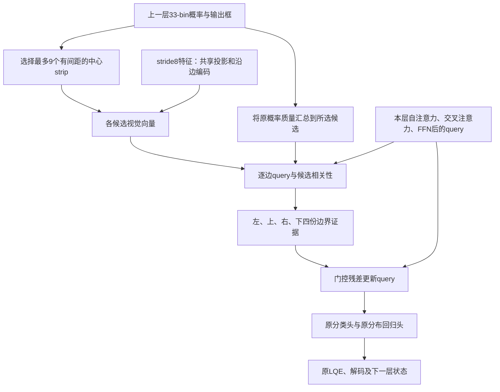

# UAVSwarm G5蒸馏消融与VisDrone稀疏strip-query实验方案

日期：2026-10-16。状态：设计文档，模型修改和训练尚未开始。

用户新增批准的优先任务是：在UAVSwarm上，对指定G5分别开启和关闭DDF分布蒸馏，做同批重新训练对照。此前认可的“少量、在空间上有区分度的候选中心strip保留边界证据，由query结合原概率选择证据，再更新query”保留为第二项VisDrone任务。

执行顺序为**先整理并实施UAVSwarm G5的DDF开/关对照，再推进VisDrone稀疏strip-query筛选**。两项实验相互独立，不将UAVSwarm结果自动外推到VisDrone，也不据此直接改变第二项的DDF设置。当前仅更新方案，不修改模型、配置或提交训练。

## 1. 分支起点和版本含义

| 用途 | 分支 | 起点 |
| --- | --- | --- |
| UAVSwarm历史最佳G5归档 | `archive/uavswarm-best-g5` | `f0756eace7096c0b3986da3d6d471d8153a6c01c` |
| 本轮实验 | `research/visdrone-sparse-strip-query` | 从上述归档分支创建，初始HEAD同为`f0756ea` |
| 后续VisDrone实验的完整归档 | `research/visdrone-boundary-refinement` | 当前归档提交`6d2ca75`，保留不变 |

选择从指定G5版本开始。该版本含原生D-FINE、旧G5和早期strip-to-query实现，便于直接核查结构差异；它尚未包含后来的候选交互、轻量概率混合、先验残差和联合微调试验，适合作为本轮独立开发起点。

这里的“UAVSwarm最佳”指用户指定的历史版本及对应作业15526：AP **61.0662**、AP75 **67.5865**、APsmall **59.7663**，均取日志epoch79。checkpoint内部`last_epoch=76`，存在历史阶段回载计数偏移；代码commit和模型checkpoint不是同一对象。历史权重位置为：

`output/uavswarm_strip_beststg2_20260923/all_layer_band2d_query_gate_full/best_stg2.pth`

以上指标来自[该commit中的原始记录](../history/all_layer_band2d_query_gate_ablation.md)，本次未重新评估UAVSwarm，也不将这一分支名称解释为经过所有训练设置、多种子比较后的统计最优结论。

第一项UAVSwarm对照的两组均只加载相同backbone预训练，重新初始化并训练检测器及G5头，不加载15526的已训练检测权重。**代码从UAVSwarm版本出发，不等于在VisDrone上加载UAVSwarm检测权重。** 第二项VisDrone筛选仍从已确认的VisDrone原版D-FINE最佳EMA开始，新模块重新初始化。

## 2. 本轮要检验的假设

第一项检验：在指定G5的结构和训练协议下，DDF是否有助于最终检测与高精度定位，或者其约束是否限制了G5修正带来的收益。此前15526及VisDrone完整训练日志已记录非零的普通辅助层和DN DDF项，因此这不是补开一项原先未使用的损失。对照只回答该UAVSwarm G5设置下DDF的整体训练作用，不预设关闭后一定更好，详细安排见第7.1节。

第二项VisDrone任务保留以下依据与结构假设。第3～6节描述该新结构，第8～9节约定其筛选协议与实现边界，不适用于第一项UAVSwarm全量训练。

已有实验说明：准确GT边界提示能带来很高的定位收益；预测候选覆盖充分，并不自动意味着模型能辨别正确边界。最近的轻量分支还显示，增加概率统计、局部邻域比较或提高学习率，未带来稳定AP75提升。

第二项检验两个问题：

1. 减少重复视觉采样，保留空间上有区分度的候选中心线，能否在降低成本的同时保留有效边界信息？
2. 让query参与候选证据选择，并将证据写回query，能否让原检测头更有效地利用这些信息？

32张验证图的既有采样诊断中，GT最近候选附近相邻位置的间距中位数约0.40输入像素，远小于stride8。它提示冗余，但不是“所有相邻候选都没有信息”或“stride8不能亚像素定位”的证明。本轮不增加更高分辨率特征。

这里的候选始终是**单条边的候选位置**，不是完整候选框；不枚举四条边组合形成的候选框集合。

## 3. 与原版D-FINE、指定UAVSwarm G5的逐项区别

以下G5指`f0756ea`的真实实现，不混入后来的自适应带宽、候选交互或32通道轻量分支。

| 项目 | 原版D-FINE | 指定UAVSwarm G5 | 本轮方案 |
| --- | --- | --- | --- |
| 主体 | HGNetv2-B4、HybridEncoder、六层decoder | 保留原主体 | 保留原主体和六层decoder |
| 普通query | 300个、256维 | 相同 | 相同 |
| 原生图像交互 | query自注意力、多尺度可变形交叉注意力、FFN | 相同 | 相同，额外读取边界证据 |
| 边界输出 | 四边各33个非均匀概率位置 | 四边各33个 | 四边各33个，数量与解码不变 |
| 新增视觉来源 | 无独立边界分支 | stride8的256维encoder特征 | 同一stride8特征 |
| 特征投影 | 不适用 | 每层各自256→64 | 整张图共享一次256→32 |
| 每边实际读取位置 | 原生交叉注意力采样点，不是33条strip | 全部33个分布候选 | 最多9个经过空间间距约束的候选 |
| 每候选采样 | 无 | 沿边5点×法向7点，法向±8输入像素 | 沿边5点×法向1点；仅候选中心线 |
| 局部编码 | 无独立strip编码器 | DW3×3、PW1×1；沿边聚合后保留7列并融合 | 共享DW一维核3、PW1×1，编码沿边5点后聚合 |
| 沿边跨度 | 不适用 | 当前层修正前预测框 | 上一层输出预测框 |
| query如何参与 | 原生注意力与检测头输入 | 生成64维通道门控，同一query全部边/候选共用 | 当前层query对各边候选作相关性评分 |
| 预测概率如何参与 | 原生回归、分布细化、LQE与解码 | 候选坐标来自分布support，原logits作为修正残差起点；MLP不直接接收log概率 | 上一层概率参与选点、形成候选组先验，并与query相关性共同决定读取权重 |
| 新视觉信息输出到哪里 | 不适用 | 逐候选logit残差 | 四条边的证据汇总后，通过门控残差写回query |
| 是否直接加边界logit残差 | 无新增残差头 | 是 | 否，使用更新后的query经过原回归头 |
| 新分支接入层 | 无 | 第1～6层，共六次 | 第2～6层，共五次；第一层保留原生计算 |
| 分类分数 | 原score head及LQE | score head仍读原query；LQE读修正分布，最终分数可能变化 | score head读更新后的query；LQE结构、输入定义保持原生方式 |
| 层间传递 | query、累计分布、预测参考框 | 额外传递修正后的分布与框，strip特征不直接写回query | 更新后的query及原头产生的分布、框沿原路径传递 |
| 新增候选间全自注意力 | 无 | 无 | 无；每边一个query读取少量候选，计算随候选数线性增长 |

旧G5的“33个概率位置”和“33次视觉采样”一一对应。本轮将两者分开：**少读视觉特征，仍用原33个概率位置预测坐标**。不把9个采样位置当成新的9-bin回归头，也不直接用9条线的加权坐标替代原D-FINE解码。

### 3.1 原版每层的数据流

```text
上一层query和参考框
  → 自注意力 → 多尺度可变形交叉注意力 → FFN
  → 本层query
  → 原分类头 / 原回归头＋上一层累计logits
  → 原LQE与Integral解码
  → 本层输出及下一层状态
```

### 3.2 指定UAVSwarm G5的数据流

```text
本层原生decoder计算 → query → 原回归头 → 本层初步分布/框
                                                   ↓
stride8特征 → 全部33候选的5×7边界带 → 64维候选特征
                                                   ↓
                         当前query产生通道门控并调制特征
                                                   ↓
                         每候选MLP → 加到原logits → 再解码
```

六层都执行这一过程。修正后的累计logits保留主路径梯度，修正后的框detach后作为下一层参考框。G5没有“strip视觉特征直接更新query”的路径。

### 3.3 本轮数据流和插入时点



选定时点为：**本层原生FFN之后、原分类/回归头之前**。不额外运行一次完整decoder或第二次本层交叉注意力。所用分布来自上一层，避免“必须先预测本层分布才能更新本层query”的循环。

第一层尚无上一层边界分布，完全使用原生路径。第2～6层读取上一层结果；更新的query可以影响当前层检测头和后续层注意力，但不会反过来改变当前层已经执行完的注意力。

新方案替换G5的额外分布修正分支，**不同时叠加旧G5 logits修正和新query修正**。旧G5类和配置保留，供结构核查及必要对照。

## 4. 空间上有区分度的中心strip如何构造

### 4.1 原33个候选与物理坐标

继续使用原`weighting_function`、固定的首层`ref_points_initial`和`reg_scale`解码四边候选坐标。不能用上一层输出框重新定义33个support位置；上一层框只提供沿边跨度及相对几何信息。

按当前输入图像宽高将归一化位置换为像素。左/上边候选顺序与右/下可能相反，选择、排序、概率归组始终同步保存原bin索引，不能把bin编号当成等间距像素坐标。

### 4.2 首轮固定选点规则

默认每边上限`max_strips=9`，最小法向间距`min_separation_px=2.0`输入像素。2像素是首轮控制重复读取的设计值，不宣称达到这个距离就保证特征独立；记录实际间距和特征相似度检验它。

每个普通query、每条边分别执行：

1. 保留中心线至少有一个有效沿边采样点的候选；剔除非有限及图像外无有效证据的位置。仅在有效集合中归一化原概率。
2. 首先选择有效集合中原概率最高的位置，概率并列时取原bin索引最小者。
3. 依次尝试加入有效物理范围的最小坐标端、最大坐标端；端点坐标并列时取原bin索引最小者，与已选位置距离不足2像素时跳过。两端用于保留低概率侧的取证机会。
4. 对其余满足间距条件的位置，计算`原概率 × 到最近已选位置的像素距离`，选择最大者；重复至9个或没有满足间距的候选。并列时按原bin索引确定顺序。
5. 按物理位置排列实际选中候选；不足9个时用无效mask补齐张量，不复制有效线凑数。

该规则读取原概率与预测坐标，不读取GT。它结合概率与空间覆盖，不是简单top-k；也不保证保留全部低概率真实边界。首轮记录GT邻近候选覆盖变化作为诊断，最终仍以完整检测指标判断收益。

选点索引、候选坐标、沿边跨度和用于读取的上一层概率detach；原生query和FDR累计分布的主路径梯度保留。这样离散选点不要求可微，也不新增“移动采样坐标以降低分支损失”的训练通路。

### 4.3 概率质量归组

将每个有效原bin分配给最近的已选中心位置，按原bin索引打破等距离并列；将分到同一位置的原概率求和，得到该strip的先验质量`π_m`。有效strip的`π`之和为1。

这能避免“只取选中bin自身概率”漏掉密集候选累积的概率质量。归组仅用于读取权重，**不改原始33-bin概率，不重新定义回归坐标**。无效位置被排除的原概率质量另行记录，不把它伪装成有效视觉证据。

全33线对照不执行最近中心归组，每个有效原bin独立保留自身的条件概率；即使两个bin物理位置相同也保留各自条目。这样该对照确实读取原逐bin先验。

### 4.4 只读候选中心线

左右边沿上一层框的上、下边范围取5点；上下边沿左、右边范围取5点。归一化沿边位置为`[0, 0.25, 0.5, 0.75, 1]`，与旧5点设置一致。

法向偏移明确为`0`，没有内、外两列。不能通过将旧`linspace(1,-1,N)`的N设成1来实现，因为那会得到偏移1而不是中心0；旧`StripProbabilityHead`本身也要求至少3列，新模块独立实现中心采样。

使用双线性插值、`align_corners=False`、`padding_mode=border`和图像内有效点mask，保持旧G5的图像边界定义。先对32维沿边序列做DW一维卷积核3和PW1×1，再按有效点聚合，得到每条strip的32维视觉向量。

任意一条边没有有效候选时，整个query的新分支返回零更新；不让全mask softmax产生NaN。实现需按batch/layer组织采样，禁止逐query复制整张特征图。

## 5. query怎样选择并接收证据

query是当前目标假设的特征向量，不是GT目标身份。候选strip提供局部视觉证据，上一层分布提供位置先验，query提供当前预测目标的上下文。

以本层query为`q_l`，第e条边、第m条strip的32维编码为`v_em`：

```text
Q_e = Wq(LayerNorm(q_l)) + edge_embedding[e]
K_em = Wk(v_em) + Wpos(relative_position_em)
s_em = dot(Q_e, K_em) / sqrt(32)
r_em = 2 * tanh(s_em / 2)
a_em = masked_softmax(log(max(π_em, 1e-8)) + r_em)
u_e = sum_m a_em * v_em
```

`relative_position`包含候选相对上一层对应边的位移，分别以该轴框尺寸和stride8归一化为两维；框尺寸使用不小于1输入像素的分母。四条边分别计算读取权重，不把左右上下候选放进一个softmax。

原概率仍参与决策；query与视觉相关性允许调整它。±2限制的是**读取权重的log分数增量**，不是原回归logits或框坐标。它是首轮稳定性选择，需要报告是否大量触顶。

将四份边界证据按左、上、右、下顺序拼接，投影回256维query：

```text
raw_delta = Wout(concat(u_left, u_top, u_right, u_bottom))
g = sigmoid(Wg(concat(LayerNorm(q_l), four_prior_entropies)))
delta = g * raw_delta
delta = delta * min(1, 0.1 * max(RMS(q_l), 1e-6) / max(RMS(delta), 1e-6))
q'_l = q_l + delta
```

`four_prior_entropies`从选点前的原33-bin有效条件分布计算：每边`H=-sum(p*log(p))/log(n_valid)`；仅一个有效bin时H=0，空边按整体零更新规则处理。熵输入detach，使用原集合保证9条与33条对照不会同时改变门控的熵定义。

`g`为每query一个自适应标量，初始0.05；`Wout`权重和偏置零初始化，保证初始`q'_l=q_l`。相对RMS上限0.1限制单次注入，避免重现旧query适配器中残差幅度大而定位改善小的现象；上限触发率必须记录，不在失败后无证据放大。

各层共享图像投影及沿边编码，query/key投影、几何/边编码、输出投影与门控按层独立。原分类头、回归头和LQE结构均不增加新模块：它们读取更新后的query及原方式产生的分布。分类分数可以随query变化，不再复制冻结基线的原分数。

## 6. 与以前UAVSwarm的strip-to-query实验有何不同

旧分支已经包含[早期预测strip实验记录](../history/prediction_guided_strip_refinement_plan.md)和`DistributionStripQueryAdapter`。其最佳AP为59.8597，原版为59.8366，不能将“把特征写回query”本身描述为本轮首次提出或已验证有效。

| 项目 | 旧UAVSwarm query适配器 | 本轮 |
| --- | --- | --- |
| 接入 | 最后两层，共享适配器 | 第2～6层；共享视觉编码、按层独立交互 |
| 采样 | 全33候选、5×3、法向±1像素、64通道 | 最多9条中心线、5×1、32通道 |
| 候选融合 | 直接按原概率平均候选特征 | query、视觉证据及原概率共同决定权重 |
| query参与候选排序 | 不参与，先按固定原概率聚合 | 在候选聚合前参与逐候选相关性计算 |
| 写回 | 四边拼接后线性投影，加到query | 四边分别读取，门控及幅度约束后写回 |
| 检测器训练 | 全部原参数冻结 | 首轮冻结backbone/encoder，decoder与新模块联合微调 |
| 分类 | 单独的基线前向提供固定分数 | 同一次前向的更新query产生分类分数 |
| decoder次数 | 基线和带适配器各一次 | 一次 |
| 监督/匹配 | 固定基线匹配，定位损失 | 原生检测criterion及当前预测的匹配 |

两者都在本层FFN之后、检测头之前注入。旧钩子只支持decoder.eval，且不允许与`distribution_refiner`同时开启；本轮需为新的训练型query路径补齐DN旁路和训练支持，不能直接删除限制后假定正确。

因此新方案与旧适配器有明确差别，但仍存在失败可能：稀疏采样可能丢失弱边界，上一层先验可能已经偏向邻近目标，特征在stride8上仍可能难以区分，query注入也可能未被原检测头有效利用。

## 7. 实验顺序与解释边界

### 7.1 第一项：UAVSwarm指定G5的DDF开/关对照

#### 两组唯一设计变量

两组均以`f0756eace7096c0b3986da3d6d471d8153a6c01c`中的`DFINEAllLayerStrip`及`dfine_hgnetv2_l_uavswarm_all_layer_band2d_query_gate_full.yml`为基准：六层各有独立修正头，每边全部33候选、每候选5×7采样、法向±8输入像素、stride8的encoder特征、64通道、DW3×3＋PW1×1、query通道门控；`use_log_prior=False`。保留原logits残差、LQE和层间传递。不开启稀疏中心strip、query写回或后来的VisDrone结构。

| 组别 | DDF权重 | 其余损失与结构 |
| --- | ---: | --- |
| `g5_ddf_on` | 1.5 | 原G5和原生criterion |
| `g5_ddf_off` | 0 | 与开启组一致，仅DDF对总损失与梯度的贡献归零 |

开关覆盖全部普通辅助层和DN的DDF蒸馏项，不只改最后一个输出键。**不能删除整个`local`损失分组**：FGL权重仍为0.15，分类、L1、GIoU、原辅助层监督、DN训练及其他既有损失全部保留。损失权重字典应以合并后的有效配置核对，防止覆盖整张字典时误删其他项目。最后层自对齐的DDF本来可能为零，不将它作为开关是否生效的唯一证据。

#### 数据、初始化与共同训练协议

- 使用旧UAVSwarm配置的完整划分：`/cluster/home/zzy/dataset/UAVSwarm-dataset-master/annotations/train_half.json`为3450图、25396框，`val_half.json`为3394图、24265框；两者图像均来自同数据集`train/`。唯一类别为`pedestrian`，`category_id=1`，保持既有类别映射，不重划子集或改为VisDrone数据。
- 两组各完整80轮、8GPU、总batch64、seed0；均从相同`weight/hgnetv2/PPHGNetV2_B4_stage1.pth`开始，encoder、decoder和六个G5头采用逐参数一致的随机初始化，优化器和EMA各自新建。使用相同数据随机种子及加载规则；只改变DDF权重不应改变模型初始化或消耗额外随机数。
- 沿旧配置联合优化其允许训练的backbone层、encoder、decoder和G5头，保留原冻结标志、AMP、同步BN、梯度裁剪、G5梯度检查点和EMA。保留原增强、多尺度、验证输入与原阶段切换；不套用第二项的固定640、冻结视觉主干或新EMA设置。
- 学习率与调度完整继承原G5配置链：AdamW主学习率2.5e-4、backbone相应组1.25e-5、weight decay1.25e-4及原参数组例外；LinearWarmup 500步、MultiStepLR milestone500/gamma0.1保持。EMA保留原decay/warmup及阶段重置规则，不为该对照引入新的调度。
- **开启组也重新训练**。历史15526只作参考，不充当新同批开启组；不把新关闭组对历史61.0662的差值直接作为DDF收益。

两组使用相同的阶段回载规则，包括原第72轮阶段切换及后续按验证结果触发的回载。DDF改变训练与验证后，两组可能选择不同的最佳权重、在不同轮触发回载，并恢复不同的优化器等状态；这属于同一规则下产生的训练效果，不要求事后强行让优化轨迹相同，也不能把它解释成仅某一步DDF梯度的直接作用。

逐轮记录外层实际epoch、优化器有效更新、学习率、回载触发事件、所加载checkpoint及其内部epoch、优化器/EMA是否回载。历史checkpoint内部epoch存在回退偏移，报告以实际外层epoch和完整验证日志为准；同时保留内部值，不能混用两种计数，或把内部epoch较小误判成少训练了几轮。元数据记录的补充不得悄悄改变原回载、调度或优化器行为。

#### DDF与其他损失的必要验证

1. 在同一真实batch、相同初始化和随机状态下比较两配置，确认模型权重、前向输出、匹配与非DDF损失一致；有效配置仅DDF权重、实验名称和输出路径不同。
2. 分别记录按原criterion完成样本归一、尚未乘DDF权重的`ddf_raw_aux_*`／`ddf_raw_dn_*`，以及实际进入总损失的`ddf_weighted_aux_*`／`ddf_weighted_dn_*`。开启组后者为前者×1.5；关闭组后者为零，raw仅作为detach诊断记录，不进入反向。两组训练分布分化后不要求raw数值仍相等。
3. 关闭组验证**DDF贡献的梯度为零**：同一前向下，将零权重DDF纳入总损失与显式移除全部DDF项的参数梯度对照，应在数值容差内相同。不能要求全部模型梯度为零；FGL、框、分类等损失仍须反向并产生实际更新。
4. 核查普通辅助层与DN的DDF开关都生效，FGL权重0.15及其他损失保留；不能因为零初始化时raw DDF较小或为零就认定未启用。用启动后的真实有效更新检查开启组出现非零DDF，关闭组加权项始终为零；必要的短验证不保存为正式训练起点，两组正式训练仍重新初始化。
5. 核查相同完整验证集、EMA评估、checkpoint保存与阶段回载记录。失败保留现场，不自动重启或以另一组历史权重补位。

#### 结果口径与实施入口

在同一完整3394图验证集上报告AP、AP75、APsmall，COCO设置和后处理完全一致。每组按总AP选择最佳轮，其余指标取**同一轮**；另报告实际epoch72～79的末8轮算术平均及逐轮走势，不拼接各指标不同峰值，也不混入回载前旧epoch的日志。比较开启与关闭两组的最佳值和末8轮均值，并结合回载事件解释差异。

这是一组seed0筛选：关闭优于开启只能支持该UAVSwarm G5协议下的观察；持平或下降也不能证明DDF对所有结构必需。结果不自动外推VisDrone，不自动修改第二项的DDF权重，不追加其他seed、原版D-FINE×DDF开/关的2×2矩阵或更多训练轮数。

计划入口如下，仅为待实现命名，当前不创建配置或提交任务：

- `configs/dfine/ablation/dfine_hgnetv2_l_uavswarm_g5_ddf_on.yml`与`dfine_hgnetv2_l_uavswarm_g5_ddf_off.yml`：共同继承指定G5配置，只分别设置DDF权重和输出信息。
- `slurm_files/run_train_uavswarm_g5_ddf_ablation.slurm`：同一入口选择开/关配置，固定80轮、8GPU、batch64、seed0，拒绝覆盖已有输出，不设置自动重试。
- 独立根目录`output/uavswarm_g5_ddf_ablation_<run_id>/`，保存`source/`、`experiment_selection.json`、任务记录、`logs/`及`results/g5_ddf_on/`、`results/g5_ddf_off/`。记录基座commit、完整合并配置、初始化来源和实际运行命令，保留15526及所有VisDrone输出。

### 7.2 第二项：VisDrone首批只设两组筛选

以下保留原稀疏strip-query方案，排在UAVSwarm DDF对照之后。UAVSwarm两组不计入这里的“两组”；本节与第8～9节仅约定VisDrone实验，不据DDF对照结果自动更改结构或损失。

| 名称 | 设置 | 回答的问题 |
| --- | --- | --- |
| 原版同预算控制组 | 原版六层D-FINE，无新增分支，按同一协议微调decoder | 训练协议本身是否保持原版性能 |
| 稀疏中心strip＋query交互 | 本文完整方案 | 整套方案能否产生稳定定位收益，成本是否可接受 |

已有最佳EMA先做初始化等价与完整验证复评，不重新训练它来获取同一个冻结基线。这里新增的原版控制组是在**新的微调协议下**检验共同退化，作用不同于重复训练未改动的静态基线。

### 7.3 VisDrone有收益后再做两个单因素对照

| 对照 | 相对主实验唯一改变 | 可解释内容 |
| --- | --- | --- |
| 全33条中心线 | 关闭空间选点，读全部有效33条中心线；其它维度、编码、交互、层数和训练协议相同 | 稀疏选点带来的精度/成本变化 |
| 仅按原概率读取 | 保留相同稀疏中心线，令`r_em=0`，候选权重直接使用归组先验；query写回与门控相同 | query条件的视觉重评分整体是否有价值 |

这两个对照不与第一批同时铺开。主方案失败时先依据诊断定位，不把四组都长时间跑完。第二项同时移除query和视觉相关性形成的重评分，不能单独归因于query信息；query仍承接证据并参与门控。该对照冻结未使用的相关性评分参数，其余模块按参数名保持相同初始化规则。

若需要回答内/中/外三列是否必要，可增加相同稀疏位置下5×3对5×1的单独对照；本轮首批不加。旧G5与新方案同时改变了采样、通道、交互和输出路径，二者差值不能单独归因于候选密度或取消内外列。

## 8. 第二项VisDrone的训练、评估与成本约定

### 8.1 VisDrone数据与初始化

- 数据：既有6471张训练图、548张验证图，10类，忽略区域/crowd及类别映射保持原定义。
- 验证标注使用已经修正的正annotation ID文件：`output/visdrone_oracle/instances_val_positive_ids.json`；训练标注沿用`output/visdrone_controlled/instances_train.json`。
- VisDrone初始权重：`output/visdrone_continue120_20261009/results/visdrone/seed0/g0/best_stg2.pth`的EMA；已有AP/AP75/APsmall为28.623509/28.440924/19.246669。
- 指定G5代码版本没有后来新增的VisDrone配置。实现时只迁入数据映射、标注引用、原版模型配置和必要的checkpoint兼容检查，不整体合并`6d2ca75`。
- 必须核对该旧代码基座下的原版结构与EMA键/形状、关闭新模块时的预测等价、完整验证口径；如不一致先解释差异，再开始比较。不能把不兼容加载当作“成功初始化”。

### 8.2 提议的筛选协议

本轮首先检验固定视觉特征下query能否利用边界信息，采用**24轮decoder联合微调筛选**，不是全模型收敛实验，也不把24轮不足以显著改善等同于该路线无效。

- backbone、encoder全部冻结并保持eval，BN统计不更新；原六层decoder、原检测头及新增模块训练。LQE结构和监督定义不变。
- 两组从同一EMA开始；decoder学习率2.5e-5，新模块1e-3，AdamW，weight decay沿用原版1.25e-4，归一化层参数不衰减，其余参数沿用相应组定义。常数学习率，无额外学习率预热；新模块靠零初始化输出和小门控起步。
- 固定640输入，水平翻转、原有框清洗及归一化；不启用新的强增强或多尺度，不改变GT过滤含义。
- 8 GPU、每GPU真实batch4、全局batch32，**不采用单卡梯度累积模拟原多卡损失归一化**。若资源不适合此配置，重新形成两组一致的预算安排，不能在排队时悄悄改变微批或归一化。
- 使用原生分类、L1/GIoU、FGL、层间分布蒸馏及辅助/DN损失，不添加GT选候选、额外边界分类损失或固定跨模型匹配。普通query的新增采样不读GT；标准训练DN仍按原版使用训练GT，DN query旁路新分支。
- AMP训练，新增选点、概率归组、注意力softmax及门控限幅以FP32计算；PyTorch2.1.2沿用兼容的`torch.cuda.amp`接口。验证FP32。
- 两组使用相同EMA策略：从初始模型复制，固定decay0.999、无随更新步数爬升的warmup；优化器重新初始化，明确记录而不伪称恢复原优化器。只在真实优化器更新后更新EMA，记录AMP跳步。
- 禁用本筛选试验中的阶段回载；保存实际全局epoch与优化器更新数，避免历史epoch偏移。每轮完整验证，保存原始模型、EMA及原生优化器状态。

冻结视觉主干和取消BN漂移，是对最近两组联合微调共同退化的控制措施，不代表已经证明BN是唯一原因。若原版控制组相对初始权重仍连续3轮AP下降超过0.5点，停止把模块组的绝对下降作结构结论，先检查共同协议。

24轮由本轮两组固定预算定义，不自动延长。筛选通过后再讨论恢复视觉主干联合训练、匹配原120轮协议和多种子复验；这些不由本方案自动启动。

### 8.3 结构成本

只计算新增边界读取，单query上限为：

| 结构 | 每次读取的采样点 | 接入次数 | 每图300个query的上限 |
| --- | ---: | ---: | ---: |
| 指定G5 | 4×33×5×7 = 4620 | 6 | 8,316,000 |
| 本轮 | 4×9×5×1 = 180 | 5 | 270,000 |

本轮采样点上限约为旧G5的3.25%，并将新采样通道由64减为32；这只是新分支读取规模，**不是整网FLOPs或耗时比例**。选点、grid_sample、编码和小算子调度都要实际计时。

首轮成本门槛：同设备同输入，整网batch1/640/FP32推理中位耗时不超过原版1.20倍；batch4/640/AMP训练步耗时不超过同协议原版1.30倍；记录峰值显存与新增参数量，新增参数目标不超过0.30M。两组使用相同测量样本、预热和同步方式，包含完整选点过程。超预算先减少实现中的重复操作，不自动沿用旧试验的成本豁免。

### 8.4 评价与推进标准

- 主要：完整548张验证的COCO AP、AP75、APsmall，maxDets=100；报告各自最佳总AP对应的一整行指标，以及最后3轮均值。
- 筛选通过标准：主实验末3轮AP75比微调前原版至少高0.3点、总AP不低于原版，并在同轮窗口优于原版控制组。单种子满足此标准只支持推进对照，不声称统计显著。
- 更新query后匹配目标可能改变；完整AP按各自预测重新匹配，不用“相同query编号”强行声称跨模型同一目标改善或变差。
- 机制诊断限定在同一次前向：有效strip数、像素间距、原概率覆盖、候选特征相似度、学习权重相对原先验变化、门控值、query相对更新量及限幅触发率。GT可用于统计真实边附近是否有候选，但不进入选点或读取权重。
- 若主实验无收益但控制组稳定，先区分视觉证据近似相同、读取权重未有效变化、query更新过小/频繁限幅、更新未转化为定位收益，再决定下一步，不默认延长轮数。

## 9. 第二项VisDrone的实现边界和必要验证

### 9.1 预计文件

| 文件 | 职责 |
| --- | --- |
| 新增`src/zoo/dfine/sparse_strip_query.py` | 物理选点、概率质量归组、单列采样与沿边编码、query读取和有界写回 |
| 新增`src/zoo/dfine/sparse_strip_query_refinement.py` | `DFINESparseStripQuery`包装器；共享投影、五层适配器、冻结视觉主干、普通query/DN分离 |
| 修改`src/zoo/dfine/dfine_decoder.py` | 为新query路径提供显式训练支持及DN数量元数据，保持旧默认路径与旧eval适配器行为 |
| 修改`src/zoo/dfine/__init__.py` | 注册新模型 |
| 新增`configs/dfine/sparse_strip_query/` | 独立VisDrone公共配置、原版控制、主实验以及后续两项对照；不继承UAVSwarm的单类设置 |
| 新增`tools/analysis/check_sparse_strip_query.py` | 初始化等价、实际更新、GT独立性、同设备成本及几何诊断 |
| 新增`slurm_files/run_visdrone_sparse_strip_query.slurm` | 明确的控制/主实验入口，使用独立源码快照，不自动重试失败任务 |
| 新增`tests/test_sparse_strip_query.py`、`test_sparse_strip_query_model.py` | 几何/掩码/概率质量/前后向/接入位置及默认兼容性 |

原solver如需支持固定BN、明确EMA初始化或关闭阶段回载，只迁入对应的最小改动与测试。具体依赖由真实初始化检查确认，不能为方便整批移入后续实验代码。

### 9.2 必要检查

1. 验证原33-bin物理坐标解码一致；左右/上下方向正确；2像素间距以当前输入尺寸计算。重复位置、只剩一个位置、无有效候选均有明确结果。
2. 中心线确实法向偏移为0；5个沿边位置与上一层框对应；越界mask、border插值、候选排序与原bin索引一致。
3. 每个有效原bin仅归入一个所选候选，归组概率和为1；不存在重复质量或把无效候选充作有效采样。全33线对照退化为原逐bin先验。
4. 零初始化输出与原版的query、分类、分布、框一致；用真实VisDrone EMA在FP32比较，再完成完整验证复评。
5. 第一层不注入，第2～6层注入时读取上一层分布，位于本层FFN与检测头之间；仅正常query进入新模块，DN路径及原辅助输出保留。
6. 新输出投影在首步获得梯度；至少3次更新后视觉编码和query/key交互参数能获得非零梯度。冻结视觉主干参数及BN不改变。
7. 门控限幅后的相对RMS不超过0.1；无候选时精确零更新；遇到非有限输入/损失明确记录并停止训练，不能用静默替换掩盖问题。
8. eval不传GT；替换/移除GT不影响普通推理结果。训练中GT只按原生匹配、损失和DN路径使用，不用于选择候选或确定权重。
9. 同一前向的最终分类、分布与框保持一致，禁止沿用旧冻结适配器的“基线分数＋新框”拼接方式。
10. 预检完成后才提交两组筛选训练；训练、配置、结果均写入新的独立实验目录，保留当前归档分支和既有checkpoint。

## 10. 证据与后续记录

当前活动方案单独保留在`docs/research/`；本分支其余历史研究文档及配套JSON归档到`docs/history/`，相互引用同步保留。当前分支可直接查阅：

- [指定G5的结构与15526结果](../history/all_layer_band2d_query_gate_ablation.md)。
- [旧二维带与strip比较](../history/all_layer_boundary_band_2d.md)。
- [早期预测候选和query适配器实验](../history/prediction_guided_strip_refinement_plan.md)。
- 源码：`src/zoo/dfine/all_layer_strip.py`、`strip_probability_head.py`、`pred_strip_head.py`、`decoder_strip_adapter.py`、`dfine_decoder.py`。

后续VisDrone记录留在`research/visdrone-boundary-refinement`，不为文档引用而复制整个旧实验目录。可使用以下命令查看原始记录：

```bash
git show research/visdrone-boundary-refinement:docs/research/session_handoff_visdrone_boundary_refinement_20261016.md
git show research/visdrone-boundary-refinement:docs/research/lightweight_joint_final_results_20261016.md
git show research/visdrone-boundary-refinement:docs/research/visdrone_candidate_interaction_analysis_20261015.md
```

本文统一记录第一项UAVSwarm G5的DDF开/关对照，以及第二项VisDrone稀疏strip-query方案和各自预算。当前仅落盘方案更新，未实现新增配置或提交任务；后续按上述先后顺序记录实际选择、预检和结果，阶段性代码及文档提交仍使用中文说明并遵循用户批准范围。
